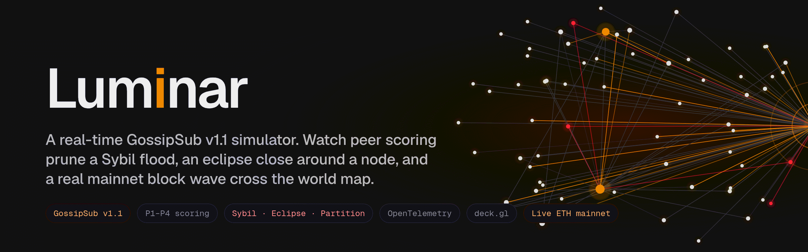
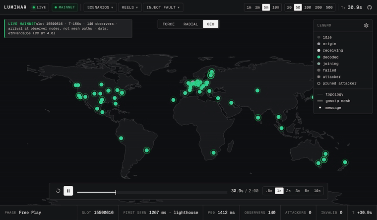
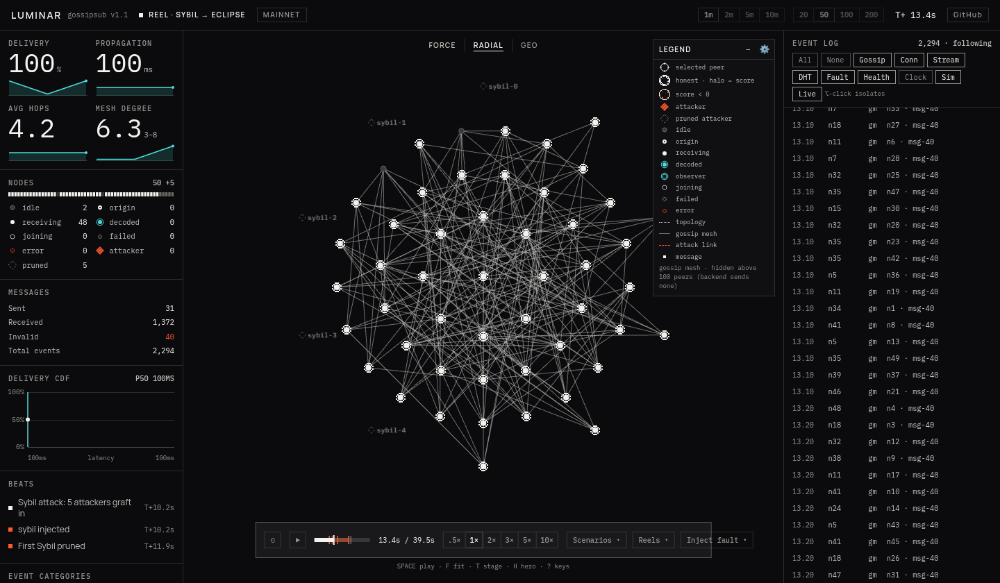
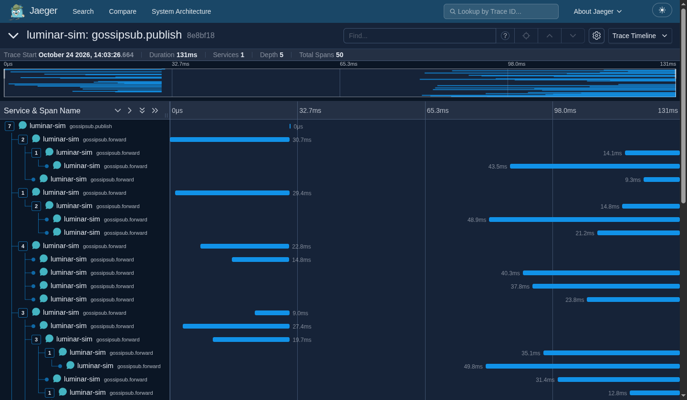
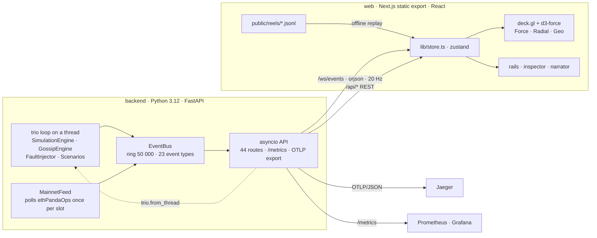
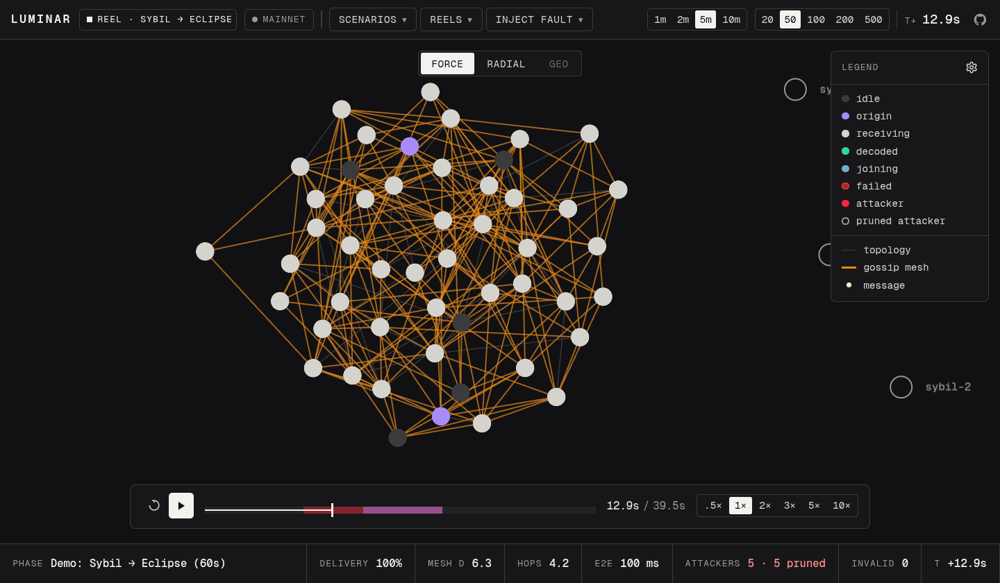

<p align="center">
  
</p>

<p align="center">
  <a href="https://github.com/yashksaini-coder/luminar/actions/workflows/ci.yml"></a>
  
  
  <a href="LICENSE"></a>
  <a href="https://github.com/sponsors/yashksaini-coder"></a>
</p>

Luminar is a real-time simulator of libp2p GossipSub v1.1: 2–500 peers run mesh maintenance, flood publish, IHAVE/IWANT and P1–P4 peer scoring in a trio loop, and a deck.gl map draws every GRAFT, PRUNE and message hop as it happens. You inject the attack (Sybil, eclipse, partition, drop, latency) and watch which ones scoring catches and which it cannot see. Same mechanism as a beacon node, toy constants.

Built for a talk at Devcon 8 (Mumbai, 3–6 Nov 2026). _Talk link added once published._

## See it




Offline, no backend: `http://localhost:3000/reels/sybil-eclipse/?theme=stage&hero=1`.

## Why

Hermes, Xatu and the ProbeLab dashboards record what the real network did; a Shadow or Testground run tells you what a scripted network would do, from logs, after it finishes. Neither lets you push one peer past the prune threshold and watch the mesh react in the same second. Luminar runs the scoring loop live with the attack as a button, so the P4 penalty, the PRUNE it causes and the mesh healing around it are one visible chain of events. The eclipse case is the point: scoring prunes the loud Sybils and never sees the quiet eclipse, and the picture shows why. It teaches the rule; it does not predict your beacon node.


> [!NOTE]
> Same mechanism, toy constants. D=6, prune at −10, heartbeat 1 s, P1–P4 only; Lighthouse runs D=8, −8000, 0.7 s, P1–P7. Reels are reproducible recordings, not identical runs. Live data is arrival at observer nodes, ~2.5 min behind, not mesh paths. Full table under [How faithful is it](#how-faithful-is-it).

## Quick start

```bash
git clone https://github.com/yashksaini-coder/luminar && cd luminar
make install   # uv sync --all-extras + npm ci (web/), ~1 min
make dev       # backend :8000 + web :3000
```

Open http://localhost:3000/sim/ and press `Space`. For the offline demo, `make web` is enough: open `http://localhost:3000/reels/sybil-eclipse/` and the frontend replays a recorded WebSocket stream with no backend and no Wi-Fi.

<details>
<summary>Requirements</summary>

Python 3.12 with `uv`, Node 22 with `npm`. `make docker` runs both halves in one container on `:8080` and needs only Docker.

</details>

## What you can do

| control | where | what it does |
|---|---|---|
| play / pause | `Space`, command strip | runs the trio simulation; `r` resets, `f` fits the view, `Esc` deselects, `?` lists the keys |
| nodes | toolbar: 20 · 50 · 100 · 200 | rebuilds the pool; the API clamps to 2–500 |
| speed · duration | strip: 0.5 · 1 · 2 · 3 · 5 · 10× · toolbar: 1m · 2m · 5m · 10m | duration auto-pauses, default 5m; Play there extends it one step |
| layout | top centre: Force · Radial · Geo | d3-force laid out once and frozen, rings by degree, world map for observer nodes |
| Scenarios ▾ | 5 scripted runs | timed phases with narrator captions, table below |
| Inject fault ▾ | partition · Sybil ×1–10 (default 5) · eclipse ×4 and drop on the selected node · clear all | latency is API-only: `POST /api/fault/latency` |
| inspector | click a node or a log row | score sparkline, mesh peers vs topology peers, live events for that peer |
| Reels ▾ | `1`–`9`, `0` back to live | 4 shipped, table below |
| stage · hero | `t` · `h`, or `?theme=stage&hero=1` | projector theme; hero hides the rails, legend and tooltip and shows the ticker; both persist in `localStorage` |
| share | `s` | copies the current URL with `&peer=<id>`, plus `&t=<sec>` in a paused reel, so a link opens that moment |


| scenario | topology | phases |
|---|---|---|
| `free_play` | random p=0.15 | none, 120 s |
| `gossip_benchmark` | scale-free m=2 | none, 90 s |
| `partition_test` | clustered, 2 groups | T+15 partition · T+35 clear · 60 s |
| `sybil_eclipse` | random p=0.2 | T+10 Sybil ×5 · T+25 eclipse peer-10 ×4 · T+40 clear · 60 s |
| `demo_sybil_eclipse` | random p=0.2 | T+10 Sybil ×5 · T+16 eclipse peer-10 ×4 · T+24 clear · 60 s |

| key | reel | nodes | size |
|---|---|---|---|
| `1` | `sybil-eclipse` | 50 | 3.6 MB |
| `2` | `partition-heal` | 50 | 4.3 MB |
| `3` | `healthy-publish` | 50 | 2.3 MB |
| `4` | `mainnet-block-wave` (real, slots 15466393–15466400) | 138 | 7.0 MB |



<details>
<summary>Recording a reel</summary>

```bash
LUMINAR_ALLOW_RECORD=1 make backend                                                              # recording is off by default; never on a public deploy
uv run python scripts/record_reel.py record sybil-eclipse demo_sybil_eclipse --nodes 50 --duration 40 --min-score-prunes 1
uv run python scripts/record_reel.py check web/public/reels/sybil-eclipse.jsonl                  # fails on dropped events
```

A reel is the `/ws/events` frame stream written to `web/public/reels/` as `<name>.jsonl` and listed in `manifest.json`.

</details>

## Live Ethereum mainnet

Click **MAINNET** in the toolbar, start the backend with `LUMINAR_MAINNET_FEED=1`, or `POST /api/live/mainnet {"enabled":true}`. The map switches to Geo and, every 12 s, replays one slot: ~150 observer nodes (138–159 seen) light up in the order they first saw that slot's block, with first sighting and p50 in the narrator and ticker. The slot shown started 13 slots (156 s, ~2.5 min) ago, which is how long the source takes to have rows; a wave is capped at 10 s so a straggler never runs into the next slot.

What it is and is not:

- Arrival at observer nodes, not mesh paths. Nobody outside the mesh sees the path.
- ~2.5 min behind the chain, polled once per slot, degrades to "no data" when the API is slow.
- Observers are snapshot nodes with real geo coordinates; the simulated peers are hidden in the Geo layout.
- Source: ethPandaOps' Xatu arrival data (`fct_block_first_seen_by_node`), CC BY 4.0, undocumented infrastructure. Notes in [docs/research-live-network.md](docs/research-live-network.md).

```bash
uv run python scripts/mainnet_to_reel.py --slots 8 --out mainnet-block-wave   # offline twin: eight real slots as a reel
```

## Observability

Luminar exports seven of the series a beacon node exports, under the same names, so the same dashboard queries work on both (not the same numbers). `/metrics` speaks Prometheus text with Lighthouse's `gossipsub_*` names: `gossipsub_mesh_peer_counts`, `gossipsub_mesh_peer_churn_events`, `gossipsub_mesh_peer_inclusion_events`, `gossipsub_score_per_mesh`, `gossipsub_topic_iwant_msgs`, `gossipsub_topic_msg_published`, `gossipsub_topic_msg_recv_counts`. Message traces go out as OTLP/JSON to `<endpoint>/v1/traces` (scope `luminar.gossipsub 0.1.0`, `LUMINAR_OTLP_TRACE_PCT` default 5, flushed every 1 s). There is no OTel SDK in the dependency tree, by design.

```bash
make otel-up                                                     # Jaeger 2.22 :16686/:4318, Prometheus 3.5 :9090, Grafana 12.1 :3000
OTEL_EXPORTER_OTLP_ENDPOINT=http://localhost:4318 make backend   # backend with trace export on
make otel-smoke                                                  # one message: Luminar → OTLP/JSON → Jaeger, round trip
curl localhost:8000/metrics                                      # Prometheus text, scraped every 5 s
```




Prometheus and Grafana bind to loopback; Jaeger binds all interfaces. Real peers can post into the same pipeline through `POST /api/telemetry/submit` or `WS /ws/telemetry`; a TELEMETRY badge appears when they do.

## How faithful is it

Short version; the full table is in [docs/protocols.md](docs/protocols.md#how-faithful-is-it).

| rule | Luminar | Lighthouse / spec | status |
|---|---|---|---|
| mesh degree D / D_low / D_high | 6 / 4 / 8 | 8 / 6 / 12 | toy constants |
| heartbeat | 1 s | 0.7 s | toy constant |
| score thresholds (graft / prune) | −5 / −10 | −4000 / −8000 / −16000 | toy constants, same decision structure |
| score components | P1–P4 | P1–P7 | P5, P6, P7 not modelled |
| eclipse visibility to scoring | P3 deficit only, floor −0.25 | same shape | faithful to the mechanism |
| flood publish, IHAVE/IWANT | first hop to all neighbours; pulls at heartbeat granularity | same; async RPC | faithful; simplified timing |
| signatures, validation, IDONTWANT | none | real | not modelled |
| determinism | wall-clock trio, unseeded | — | reproducible recordings, not identical runs |

## Architecture

The simulation runs in a trio loop on a background thread; the API is asyncio (uvicorn). Cross-thread calls go through `trio.from_thread`, and nothing in an asyncio handler blocks the trio loop. One WebSocket carries everything to the browser.



| path | what lives there |
|---|---|
| `backend/simulation/` | engine, clock (play / pause / seek / speed), node pool 2–500 |
| `backend/gossip/` | GossipSub v1.1, P1–P4 scorer, message traces, delivery analytics |
| `backend/fault/` | partition, Sybil, eclipse, drop, latency |
| `backend/topology/` | 8 generators: random, scale-free, clustered, small-world, complete, ring, star, tree |
| `backend/events/` | bus with a 50 000-event ring (`LUMINAR_RING_SIZE`), 23 typed events, `/ws/events` batched at 50 ms |
| `backend/concurrency/` | stream semaphore 64, DHT semaphore 8 |
| `backend/scenarios/` | 5 scripted scenarios, timed phases, narrator captions |
| `backend/live/` | mainnet feed |
| `backend/otel/` | OTLP/JSON exporter, Prometheus `/metrics` |
| `backend/telemetry/` | ingest from real peers |
| `backend/metrics/` | collector behind the stats panel |
| `web/app/` | routes: `/` landing, `/sim/`, `/reels/[name]/`, `/figure/` |
| `web/components/map/` | deck.gl renderer, frozen d3-force layout, icon atlas |
| `web/components/sim/` | toolbar, command strip, rails, inspector, narrator, legend |
| `web/components/dither/` | Bayer 8×8 dither, halo ring, diamond, stamp, figure, loupe |
| `web/lib/` | zustand store, REST + WebSocket + reel player, `copy.ts` |
| `web/remotion/` | the launch video (`npm run video`, local Chrome) |
| `scripts/` | `record_reel.py`, `mainnet_to_reel.py`, `otel_smoke.py` |

Swagger at http://localhost:8000/docs: 24 GET, 18 POST, 2 WebSocket routes. Details in [docs/architecture.md](docs/architecture.md) and [docs/backend.md](docs/backend.md).

## Development

```bash
make check       # lint + test + web-check + build (ruff, pytest, tsc/eslint/unit tests, next build)
make test        # uv run pytest tests/ -v, 126 tests in 15 files, trio mode
make lint        # ruff check + ruff format --check, line length 100
make typecheck   # cd web && npx tsc --noEmit
make web-check   # tsc + eslint + unit tests
make fmt         # ruff format
```

Tests are `async def` under trio; a fixture builds `EventBus` → `SimulationClock` → engine by hand, see `tests/test_gossip_engine.py`. Commits follow `type(scope): message` with scopes `backend`, `web`, `video`, `deploy`.

## Deploy

```bash
make docker      # builds web/, serves it with the backend from one container on :8080
```

`render.yaml` and `.do/app.yaml` use the same root `Dockerfile` (the DigitalOcean spec boots 50 nodes). Set `LUMINAR_ADMIN_TOKEN` on anything public: every non-GET request then needs an `X-Luminar-Token` header and visitors get a read-only viewer plus the reels.

<details>
<summary>Environment variables</summary>

| variable | default | |
|---|---|---|
| `PORT` | 8080 | container port |
| `LUMINAR_NODE_COUNT` | 20 | peers at startup |
| `LUMINAR_LOG_LEVEL` | INFO | Python and uvicorn log level |
| `LUMINAR_ADMIN_TOKEN` | unset | when set, non-GET requires `X-Luminar-Token` |
| `LUMINAR_ALLOW_RECORD` | unset | `1` enables `/ws/events?record=<name>`; never on a public deploy |
| `LUMINAR_MAINNET_FEED` | unset | `1` starts the mainnet feed at boot |
| `LUMINAR_RING_SIZE` | 50000 | event ring buffer, ~12 MB; raise it on a laptop, not on a 512 MB instance |
| `OTEL_EXPORTER_OTLP_ENDPOINT` | unset | enables OTLP/JSON trace export |
| `LUMINAR_OTLP_TRACE_PCT` | 5 | percentage of message traces exported |
| `NEXT_PUBLIC_API_URL` | same origin | build-time; where the frontend finds the API |

</details>

## Docs

- [docs/protocols.md](docs/protocols.md): GossipSub v1.1, P1–P4 scoring, backoff, semaphores, the faithfulness table
- [docs/architecture.md](docs/architecture.md): threading model and data flow; its embedded diagram (`assets/architecture.png`) predates the Next.js rewrite in `web/`
- [docs/backend.md](docs/backend.md): modules, engine, event system
- [docs/ui.md](docs/ui.md): panels, inspector, keyboard
- [docs/deployment.md](docs/deployment.md): Docker, Render, DigitalOcean, env vars
- [docs/research-live-network.md](docs/research-live-network.md): mainnet data sources and what they can and cannot show
- [docs/roadmap-devcon8.md](docs/roadmap-devcon8.md): plan of record for the talk
- [docs/readme-assets.md](docs/readme-assets.md): how every image and GIF above is regenerated

## Devcon 8



The stage build is `/reels/sybil-eclipse/?theme=stage&hero=1`; `t` and `h` toggle the same at a live backend. Mumbai, 3–6 Nov 2026.

## License

[MIT](LICENSE).
