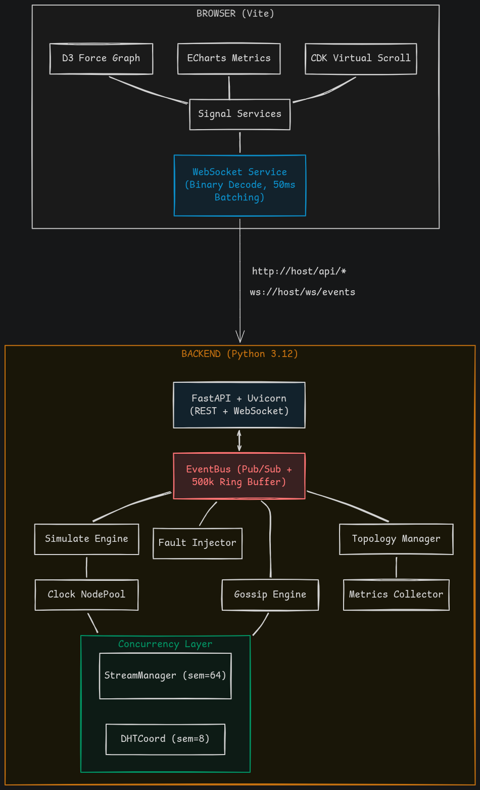
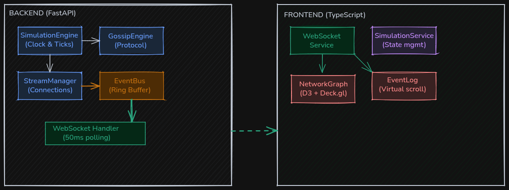

# 3. System Architecture

## 3.1 High-Level Overview

Luminar follows a **client-server architecture** with an event-sourced backend and a reactive frontend. All P2P simulation happens server-side; the frontend is a pure visualization layer.

  

## 3.2 Data Flow

### Event Flow (Backend → Frontend)

  

## 3.3 Threading Model

- **asyncio** (uvicorn) runs the FastAPI app: REST handlers, the WebSocket fan-out, static files.
- **trio** runs the simulation on one background **daemon thread** (`_start_sim_thread` in
  `backend/main.py`). Handlers reach it through `trio.from_thread` and the trio token; the
  thread is never joined.
- **Startup** (`lifespan`): `_build_simulation(n)` → `_start_sim_thread()` →
  `telemetry_manager.start()` → optional `otlp_exporter.start()`.
- **Shutdown**: `telemetry_manager.stop()` → `otlp_exporter.stop()` → `engine.clock.stop()`.
- `/api/sim/reconfigure` rebuilds the engine and spawns a fresh trio thread under a lock.

## 3.4 Communication Protocols

### REST API
- **Purpose**: User-initiated actions (play, pause, inject fault, apply topology)
- **Format**: JSON request/response
- **Endpoints**: generated reference at `/docs` (Swagger UI)
- **Dev proxy**: Next (`web/next.config.ts`) rewrites `/api` to `http://localhost:8000`; the
  WebSocket connects to `NEXT_PUBLIC_WS_URL ?? ws://localhost:8000` in dev
- **Production**: `backend/main.py` mounts `frontend/dist` (= `web/out`, the Next static export)
  with `StaticFiles(html=True)` at `/` (same origin, no proxy)

### WebSocket
- **Purpose**: Real-time event streaming (backend → frontend)
- **Format**: Binary (orjson bytes → ArrayBuffer)
- **Endpoint**: `/ws/events`
- **Frequency**: 50ms poll batches (20 Hz)
- **Reconnect**: 2 second auto-reconnect on disconnect

### Why Single WebSocket?
A single WebSocket connection carries all event types. The frontend filters client-side. This design:
- Reduces connection overhead (one TCP connection vs. many)
- Simplifies server-side fan-out (one subscriber per client)
- Enables unified event ordering (total order across all event types)
- Makes replay straightforward (single event stream to record/replay)