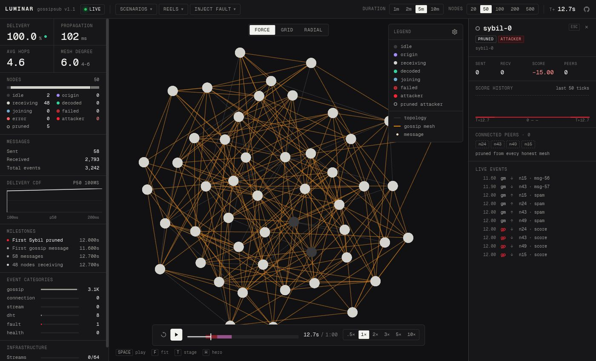
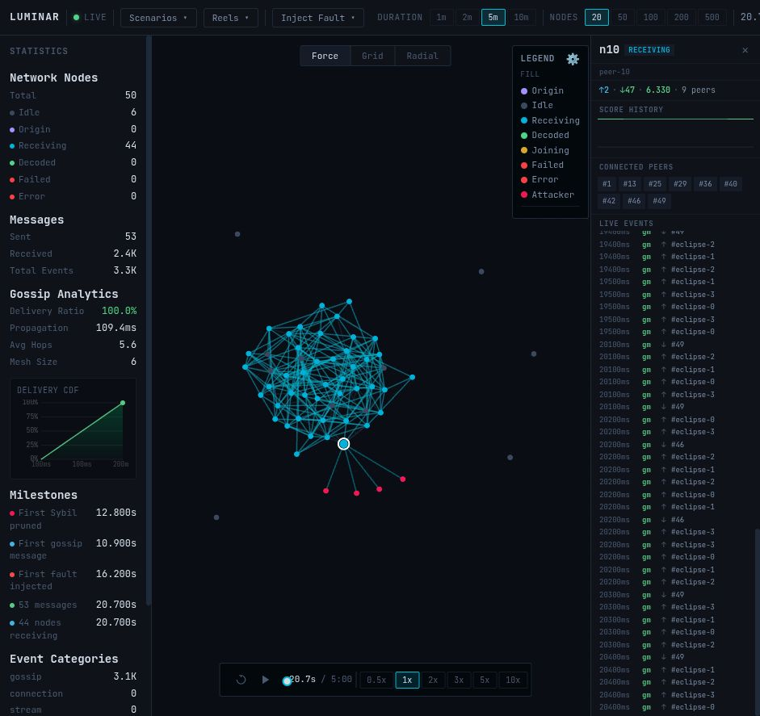
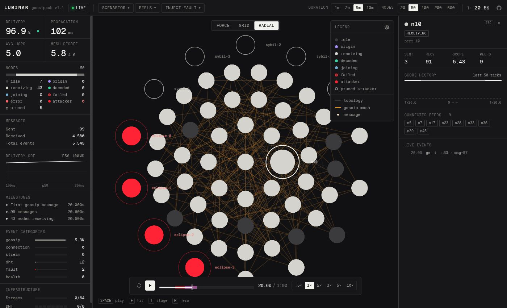

# Luminar UI reference

Screenshots of the live main UI (50 nodes, `demo_sybil_eclipse`), from `assets/`:

| Moment | Image |
|---|---|
| T+11.9s: five Sybils grafted (red), `sybil-0` selected in the inspector |  |
| T+20.7s: Sybils pruned by score (hollow grey, parked beside their victims), peer-10 eclipsed |  |
| Radial layout at the same moment |  |

Verified against the `feat/redesign` working tree on 2026-10-19 (the Ember redesign on top of `2d0a6a4`). Paths are relative to the repo root; frontend paths are under `frontend/src/` unless stated. This is a reference for the person presenting Luminar on stage and for contributors touching the frontend. Trust code over this file.

## 1. Screen map

One page, no routing. A 44px toolbar spans the top. Below it are three columns: a statistics panel on the left (fixed 256px), the deck.gl map in the centre (flex), and the event log on the right (fixed 300px) (`style.css:190-223`). Every surface is flat: separation is a surface step plus a 1px hairline, no box shadows (the one permitted glow is the LIVE dot). The timeline bar floats over the bottom of the map (76% wide, 360–820px, `bottom: 36px`). The peer inspector (300px) slides in from the right over the event-log column; the telemetry panel (272px) slides in from the left. The legend/settings card (176px) sits top-right of the map. The Force/Radial/Geo switcher is top-centre of the map (`left: 50%; translateX(-50%)`, `style.css:448-452`) and the narrator caption card sits directly below it, also centred (`top: 56px`). A row of keyboard hints (`SPACE play · F fit · T stage · H hero`, `#lm-kbd`) sits bottom-left of the map (`index.html`, `style.css:479-491`) and the fault toast appears top-left under the toolbar. In hero layout the side columns, inspector, kbd row and tooltip are hidden and a 44px ticker strip appears along the bottom (`style.css:597-633`).

```
┌──────────────────────────────────────────────────────────────────────────────┐
│ LUMINAR gossipsub v1.1 [●LIVE] [TELEMETRY n] | Scenarios▾ Reels▾ Inject Fault▾│
│            DURATION 1m 2m [5m] 10m  NODES [20] 50 100 200 500 | T+ 12.3s  (gh)│
├────────────┬──────────────────────────────────────────────┬──────────────────┤
│ Delivery   │ (toast)      FORCE|GRID|RADIAL      Legend ⚙ │ Event log        │
│ Propagation│            ┌─ T+10.0s · PHASE ─┐              │   1,284 · following│
│ Hops Mesh d│ ┌telemetry┐└───────────────────┘      ┌peer──┐ │ All None Gossip… │
│ NODES  50  │ │ drawer  │        deck.gl canvas     │inspec│ │  10.42 n3 gm …   │
│ ▇▇▇▇▇▇▇▇▇  │ │ (left)  │        + ring canvas      │tor   │ │  10.45 n7 gf …   │
│  idle …    │ └─────────┘                           │(right│ │  …               │
│ MESSAGES   │                                       │ over │ │                  │
│ CDF        │      ┌──────────────────────────────┐ │ log) │ │                  │
│ MILESTONES │      │ ⟲ ▶ ═══════●═══════ 12.3s/1:00│ └──────┘ │                  │
│ CATEGORIES │      │   .5× [1×] 2× 3× 5× 10×       │          │                  │
│ INFRA      │ SPACE play F fit T stage H hero ────┘          │                  │
│            │ [hero only] phase · delivery · mesh d · hops · e2e · attackers · invalid · T │
└────────────┴──────────────────────────────────────────────┴──────────────────┘
```

Type is Geist Mono (`--lm-font`, self-hosted via `@fontsource/geist-mono`, `style.css:3-7, 74`), falling back to `"JetBrains Mono", ui-monospace, monospace`; Geist sans (`--lm-font-say`) is used only for the narrated caption sentence. Base is 12px/1.4 with tabular numerals. Tokens (`style.css:18-103`): chrome `--lm-bg #111113`, `--lm-panel #171719`, `--lm-raised #232326`, `--lm-hover #29292c`, `--lm-border #2d2d30`, `--lm-border-strong #3b3b3e`; text `--lm-fg #f2f2ef`, `--lm-fg2 #9a9994`, `--lm-fg3 #74736f`; `--lm-accent oklch(72% 0.166 60)` (tangerine: the live mesh and nothing else), `--lm-accent-bright oklch(80% 0.117 60)`, `--lm-accent-pale oklch(88% 0.076 60)`; `--lm-danger oklch(64% 0.245 25)` (attackers and failures only), `--lm-danger-text oklch(78% 0.15 22)`; `--lm-ok #34d399`; `--lm-online #22c55e`. The legacy names (`--bg`, `--panel`, `--text`, `--accent`, `--green`, `--red`, `--font`, …) alias these (`style.css:118-133`). `color-scheme: dark` is declared; `:focus-visible` gets a 2px accent outline; `prefers-reduced-motion` zeroes the hover/drawer/pulse durations and removes the caption transition and drain animation (`style.css:113-115, 1079-1084`).

## 2. How the network is rendered

Two stacked canvases live inside `#map-container`: `#deck-canvas` (WebGL, deck.gl 9.2 with an `OrthographicView`, `controller: true` for pan/scroll-zoom) and `#ring-canvas` (2D, pointer-events none, kept sized but unused since labels moved to deck). `renderLayers()` in `map/renderer.ts` is the single frame builder; it runs on every WebSocket snapshot, every d3-force tick, hover/click, pref change, and from a rAF loop only while pulses or particles exist. An idle sim draws nothing new. The cursor is `pointer` over a node and `grab` elsewhere. Every colour deck draws comes from the `--lm-node-*` / `--lm-map-*` tokens: `refreshPalette()` in `palette.ts` re-reads them with culori whenever `data-theme` flips, so the stylesheet is the single source of truth for the map as well.

### 2.1 Two kinds of edge

| Term | Source | Store field | Meaning |
|---|---|---|---|
| Topology edge | `GET /api/topology/edges` + WS `edges` frame | `store.edges` | Physical libp2p connection. Fixed by the topology generator; changes only on reconfigure or scenario launch. |
| Mesh edge | `snapshot.gossip.mesh` | `store.mesh` | GossipSub mesh membership for the single topic (`peer_id → GRAFTed peers`). Subset of topology edges; changes every heartbeat via GRAFT/PRUNE. Backend sends `{}` above 100 nodes, so the overlay vanishes on the 200/500 presets. |

Attackers (`sybil-N`, `eclipse-N`) are never in `store.edges`. `recomputeLayout` synthesises links from their `connected_peers` (or, once pruned, `last_targets`) for layout only; on screen their graft relationships are drawn as red *attack links* (2.2 row 1a), and attacker pairs are excluded from the mesh overlay.

### 2.2 Layers in draw order (later = on top)

| # | Layer id | Type | Shown when | Colour / size |
|---|---|---|---|---|
| 1 | `edges` | LineLayer | Edge lines toggle on, topology edges exist | `--lm-map-topology #3b3b3e`, alpha .9 (force) / .36 (grid, radial), width 1 |
| 1a | `attack-links` | LineLayer | toggle on, a grafted attacker exists | `--lm-map-attack-link oklch(64% 0.245 25 / 0.35)`, one line from each attacker to each victim, alpha .35 / .14, width 1 |
| 1b | `mesh-edges` | LineLayer | toggle on, mesh non-empty | `--lm-map-mesh oklch(72% 0.166 60 / 0.42)` tangerine, alpha .42 / .17 (.6 under stage), width 1.5, honest pairs only, deduped undirected |
| 2 | `hover-edges` | LineLayer | a node is hovered | `--lm-map-ring-hover rgb(242 242 239 / 0.45)` × 0.9 (alpha ≈ 103), width 2 |
| 2b | `hover-peer-rings` | Scatterplot (stroked) | same | same colour, radius + 4, 1px, around the hovered node's peers |
| 3 | `pulses` | Scatterplot (filled) | a node changed state in the last 800 ms | 2.5× node radius disc in the new state's colour, alpha 56 → 0 linear |
| 3.5 | `particles` | Scatterplot (filled) | particles alive | see 2.5 |
| 4a | `attacker-halos` | Scatterplot (stroked) | a grafted attacker (non-empty `connected_peers`) | `--lm-node-attacker` at alpha 140 (~.55), 1.7× radius, 1px |
| 4 | `nodes` | Scatterplot (filled + stroked) | always | fill by state (2.3); stroke 1.25px `--lm-danger` for `failed`, 1.5px `--lm-node-pruned` for a pruned attacker (whose fill is `--lm-bg`, i.e. a hollow ring); 1.5× radius when selected, 1.15× for attackers. Only pickable data layer |
| 4b | `telem-rings` | Scatterplot (stroked) | node has `is_telemetry` | `--lm-map-ring-telemetry #22c55e`, 1.6× radius, 1.5px, alpha .2 → .75 on a 5.6 s sine |
| 5 | `selection-ring` | Scatterplot (stroked) | a node is selected | `--lm-map-ring-select #f2f2ef`, 2× radius, 2px |
| 6 | `event-highlight-edges` | LineLayer | selected node + `highlightPeers` (set by an event-log click) | `--lm-map-ring-highlight oklch(88% 0.076 60)` pale tangerine, alpha 161, width 2.5 |
| 6b | `event-highlight-rings` | Scatterplot (stroked) | same | same colour at alpha 230, 1.8× radius, 1.5px |
| 7 | `labels` | TextLayer | Node labels toggle on and Geist Mono has loaded | attackers always (raw `sybil-N` id), plus the selected and the hovered node (`nN`); 10px Geist Mono 500 (12px under stage), anchored just right of the disc; `--lm-fg` for honest nodes, `--lm-danger-text` for a grafted attacker, `--lm-node-pruned` for a pruned one |

Node radius: `clamp(200/√n, 3, 8) × scale.node`, then ×0.5 in grid/radial. At 50 nodes that is 8 world units in force mode, 4 otherwise. `scale.node` is 1.4 under the stage theme; `scale.edgeAlpha` 1.6 multiplies the topology and attack-link alpha (the mesh has its own stage token).

### 2.3 Node states and colours

`STATE_COLORS` is filled from the `--lm-node-*` tokens by `refreshPalette()` (`palette.ts:63-72`; tokens `style.css:45-53`).

| State | Colour | Meaning |
|---|---|---|
| idle | `#3b3b3e` dark grey | no activity |
| origin | `#a78bfa` violet | published the current message |
| receiving | `#d5d3ce` warm light grey | message in flight to it |
| decoded | `#34d399` green | delivered |
| joining | `oklch(72% 0.08 235)` muted blue | churn join |
| failed | `oklch(45% 0.13 25)` dark red fill + 1.25px `--lm-danger` stroke | node down (Drop Peer) |
| error | `oklch(70.4% 0.191 22.2)` red | fault-injected error |
| attacker | `oklch(64% 0.245 25)` danger red, 1.15× radius, halo ring | sybil / eclipse node grafted into at least one honest mesh |
| pruned (derived) | hollow: fill `--lm-bg`, 1.5px `--lm-node-pruned #9a9994` ring | attacker with zero `connected_peers` |

Pruned-attacker rule (`palette.ts:79-96`): an `attacker` with zero `connected_peers` (every honest mesh has PRUNEd it) loses its halo and is drawn as a hollow grey ring; its label turns grey too. This is the on-screen signal that P4 scoring worked. Unknown states fall back to idle.

Ring semantics at a glance: white thick = selected; faint warm-white thin = peers of the hovered node; green breathing = real telemetry peer; pale tangerine = targets of a clicked event-log row; red halo = grafted attacker; grey hollow = pruned attacker; coloured fading disc = just changed state.

### 2.4 Layouts (`map/layout.ts`)

| Mode | How it is built | Notes |
|---|---|---|
| Force (default) | Live d3-force: link strength 0.4 at `max(40, 400/√n)`, charge −800, weak centre, collide. Nodes seen before keep their positions; new ones seed on a circle. If fewer than 80% of nodes are reused, 80 synchronous warm-up ticks run first. | Grafted attackers get links to their victims so they sit next to them. A pruned attacker gets a *weak* tether (strength 0.2, distance 1.6×) to up to two of its `last_targets` (victims at injection time, `backend/simulation/engine.py:133`) so it parks beside the cluster instead of drifting off (`app.ts:65-73`, `map/layout.ts:69-70`). `fitView` 200 ms after start. |
| Geo | Nodes at producer-projected lat/lon (`x = lon·2.5`, `y = −lat·2.5`) over Natural Earth 110m land outlines (public domain, `frontend/public/geo/land-110m.json`, 84 KB, loaded on first use; fit-to-view frames the whole world); simulated peers are hidden. | Offered only while real observers are on the canvas (the tab is disabled otherwise); selected automatically once per feed-on or real reel; the previous layout is restored when the feed turns off or the reel is left; a scenario or fault click leaves Geo so the simulation is visible. |
| Radial | Highest-degree node at centre, rings outward by degree, at least 6 per ring. | Degree counts attacker links. |

Layout is recomputed only when the sorted node-id set, the edge set, or the mode changes (`topoKey`); state changes alone never relayout.

### 2.5 Particles

`spawnParticle(from, to, kind | rgba, fizzle)` in `map/renderer.ts`. `kind` is one of `message | sybil | graft | prune | dht | fault`, each mapped to a token (`palette.ts:102-105`). No-op when particles are disabled (legend toggle, or `prefers-reduced-motion`), when 600 are alive, or when either peer is unknown.

| Event | Particle |
|---|---|
| `GossipMessage` (from and to set) | one per hop; `message` = `--lm-map-particle oklch(95% 0.045 60)` warm white; `sybil` (= `--lm-node-attacker` red) if the sender id starts with `sybil-`; `dropped: true` → fizzle, drawn in `error` red |
| `GossipGraft` | `graft` = `--lm-ok #34d399` |
| `GossipPrune` | `prune` = `--lm-node-attacker` red |
| `DHTQueryStarted` | `dht` = `#a78bfa` violet, to one random connected peer |
| `FaultInjected` | up to 4 `fault` (= `--lm-danger`) particles from the target to its first 4 peers, **only when `target` is a node id** (Drop Peer, Eclipse). Partition's target is `"network"`, Sybil's is the topic `lumina/blocks/1.0`, Latency's is `a<->b`; none resolves in `store.nodeIndex`, so those faults draw no burst (`app.ts:227-239`) |

Motion: 800 ms travel with ease-out along a quadratic Bézier bowed to the left of travel (so A→B and B→A do not overlap), lifetime 1200 ms, so a delivered particle rests on its target at half alpha for 400 ms (alpha 242 → 121). Radius is 0.3× the node radius × `scale.particle` (1.8 under stage), clamped to 1.9–3.4 px. A fizzling (dropped) particle stalls at 60% of the arc and fades out from alpha 89 at 0.9× size.

### 2.6 Pulses, tooltip, fitView, labels

- Pulse: any node whose state changes to a non-idle value (an attacker's graft ↔ prune flip counts) gets a 2.5× disc in the new colour for 800 ms.
- Tooltip (hover): a 200px raised card placed at cursor +16/−10 px and clamped inside the map (`map/renderer.ts` `showTooltip`). Header: short name (`n<index>` for `peer-*`, raw id for attackers) and a state badge in the state colour (`PRUNED` in grey for a pruned attacker; attackers in `--lm-danger-text`), then the shortened peer id. Honest rows: `peers`, `score` (signed, red when negative), `sent · recv`, plus `mesh N sybil grafts` in red when its mesh contains attackers. Attacker rows: `grafted into N meshes`, `score`, `sent · recv`, then the victims' short names.
- `fitView`: bounding box of all positions, zoom capped at 4, 500 ms transition. Fired after layout, on key `f`, and exposed as `window.__luminar.fitView`. `window.__luminar` also exposes `store` and `viewState()`.
- Node labels: drawn by the `labels` TextLayer (2.2 row 7) for attackers always and for the selected and hovered node; the layer waits for `document.fonts.load('500 10px "Geist Mono"')` so the atlas is baked with the right face. `map/overlay.ts` keeps `#ring-canvas` sized but draws nothing.

## 3. Toolbar

`frontend/index.html`. Left to right.

| Control | What it does |
|---|---|
| `LUMINAR` + `gossipsub v1.1` | static brand text; the sub-label is hidden under the stage theme |
| Connection pill | `OFFLINE` (red-tinted pill, socket closed), `LIVE` (green dot with the one permitted glow, socket open), `REEL · <title>` (square white dot; a reel is loaded, wins over the socket state). Reconnect backoff 1 s → ×2 → 10 s cap. Single-socket invariant: `connect()` while a socket is connecting/open is a no-op and callbacks of a superseded socket are dropped (`api/websocket.ts:67-71, 74, 81, 94`), so key `0` / `Back to live` pressed twice cannot open two sockets |
| `TELEMETRY n` badge | hidden until an external peer POSTs to `/api/telemetry/submit`; click opens the telemetry drawer |
| `Scenarios ▾` | list from `GET /api/scenarios`; click launches (see 3.1). Items carry the scenario description as a hover tooltip |
| `Reels ▾` | list from `/reels/manifest.json`; numbered 1–3 plus `0 Back to live` (see 3.2). Items carry the manifest blurb as a hover tooltip |
| `Inject Fault ▾` | five items with an aside each (`split in half`, `5 peers`, `on selected`, `select a node`; see 3.3) |
| `DURATION 1m 2m 5m 10m` | sets `store.maxDuration` (60/120/300/600, default 5m). No backend call. It is the scrubber denominator only while no scenario is active (`timelineTotal()`, `store.ts:80-83`) and the auto-pause point; the client POSTs `/api/sim/pause` when sim time reaches it. Refused with a toast in reel mode |
| `NODES 20 50 100 200 500` | `POST /api/sim/reconfigure {n_nodes}`; backend clamps `n` to 2–500 (`backend/main.py:316`), tears down the trio thread and rebuilds everything (random topology, `p = clamp(6/n, 0.08, 0.4)`), paused at t=0. Clears faults and the active scenario. The active button follows `node_count` from every snapshot, so it is right whatever the backend booted with (Render 20, DigitalOcean 50). In reel mode the presets are no-ops with a toast (`Press 0 to leave the reel first`) |
| `T+ 0.0s` | sim time; `12.3s` under a minute, `m:ss` after |
| GitHub icon | link to the repo |

Dropdown behaviour: opening one dropdown closes the other two; any click outside a `.dd-wrap` closes all three. The `DURATION`/`NODES` labels are hidden under the stage theme to make room for the 1.3× zoom.

### 3.1 Scenarios

Launch = `POST /api/scenarios/{id}/launch {speed}`. Backend clears faults, resets clock, event bus, gossip state and run id, regenerates the scenario's topology with the current node count, arms the phase runner, clamps speed to 0.1–100 and starts playing. A launch always auto-plays (`backend/main.py:804-857`). The phase runner polls every 200 ms and fires a phase only while the clock is running (`not clock.paused`) and `clock.time >= phase.at`, at most one phase per poll (`backend/scenarios/runner.py:68-95`): a seek while paused fires nothing until Play, and a seek past several phases fires them one per poll, ~200 ms apart. Each fires a `ScenarioPhaseFired` event whose label becomes the caption. `duration` sets the timeline span while the scenario is active (section 4) and is otherwise informational.

| id | Menu label | Topology | Phases (sim seconds) |
|---|---|---|---|
| `free_play` | 🎮 Free Play | random p=0.15 | none |
| `gossip_benchmark` | 📡 Gossip Benchmark | scale-free m=2 | none |
| `partition_test` | ⚡ Partition Recovery | clustered, 2 clusters, intra 0.4 / inter 0.05 | T+15 partition (split half) "Partitioning network — mesh splits"; T+35 clear "Clearing partition — mesh healing" |
| `sybil_eclipse` | 🕵️ Sybil + Eclipse Attack | random p=0.2 | T+10 sybil n=5 "Injecting 5 Sybil attackers into mesh"; T+25 eclipse peer-10 n=4 "Launching Eclipse attack on peer-10"; T+40 clear "Clearing all attacks — recovery phase" |
| `demo_sybil_eclipse` | 🎬 Demo: Sybil → Eclipse (60s) | random p=0.2 | T+10 sybil n=5 "Sybil attack: 5 attackers graft in"; T+16 eclipse peer-10 n=4 "Eclipse on peer-10"; T+24 clear "Faults cleared — mesh healing" |

Free Play's description mentions a "Fault tab" and "latency"; neither exists in the UI (`/api/fault/latency` has no control).

### 3.2 Reels

Static files under `frontend/public/reels/` fetched from the frontend origin (not `VITE_API_URL`). Selecting one closes the WebSocket (no reconnect), loads the JSONL, seeks to the first snapshot so the graph is visible before play, and writes `?reel=<name>` to the URL. `0 Back to live` (or key `0`) stops the reel and reconnects. If the `.jsonl` fails to load from the menu, `exitReel()` restores live. Keys `1`/`2`/`3` are no-ops when `manifest.json` failed to load.

| # | name | Title | Nodes | What happens |
|---|---|---|---|---|
| 1 | `sybil-eclipse` | Sybil → Eclipse | 50 | T+10 five Sybils graft in and flood; P4 scoring prunes them in two heartbeats. T+16 peer-10 is eclipsed by silent attackers scoring cannot see. T+24 faults clear. ~40 sim-s |
| 2 | `partition-heal` | Partition → Heal | 50 | T+15 mesh split in two, delivery halves; T+35 partition clears and the mesh heals. ~50 sim-s |
| 3 | `healthy-publish` | Healthy mesh | 50 | Scale-free, no faults: flood publish, mesh relays, IHAVE/IWANT pulls. ~30 sim-s |

### 3.3 Inject Fault

All calls are fire-and-forget. The toast top-left under the toolbar (2 s, neutral raised card, `app.ts:532-541`; the red `.lm-injected` variant in `style.css:406-407` is never applied) shows whether or not the call succeeded: `api.post()` swallows network errors and non-2xx and resolves to `null` (`api/client.ts:15-25`), and every menu handler chains `.then(() => showFaultFlash(...))` unconditionally (`app.ts:420-449`), so an offline backend still toasts "Sybil Attack injected". In reel mode the menu is refused with `Press 0 to leave the reel first` (`reelGuard`, `app.ts:109-113`). Every fault emits `FaultInjected`; the red particle burst (2.5) is drawn only for Drop Peer and Eclipse, whose `target` is a node id.

| Item | Call | Target | Backend effect |
|---|---|---|---|
| Network Partition | `POST /api/fault/partition` | `store.nodes` split by array index: first half vs second half (may cut through clusters; includes attacker ids and telemetry peers) | any message between the groups is blocked |
| Sybil Attack | `POST /api/fault/sybil` | fixed 5 attackers on `lumina/blocks/1.0` | `sybil-N` nodes force-grafted into 4 random honest meshes each; empty own mesh so they never relay |
| Eclipse Attack | `POST /api/fault/eclipse` | selected node, else `nodes[0]` | target removed from its honest neighbours' meshes; its mesh replaced by 4 `eclipse-N` attackers that connect only to it. Only `GossipEngine._mesh` is rewritten; `NodeInfo.connected_peers` (topology adjacency) is untouched (`backend/fault/injector.py:256-279`) |
| Drop Peer | `POST /api/fault/drop` | selected node; silently does nothing without one | state → `failed`, score 0, removed from all meshes |
| Clear All Faults | `POST /api/fault/clear-all` | — | dropped peer → idle, score 1.0, `PeerRecovered`; attackers removed from meshes/subscriptions; `FaultCleared` |

Backend controls with no UI besides `/api/fault/latency`: `/api/fault/clear` (single fault), `/api/fault/active`, `/api/topology/apply|preview|metrics|list`, `/api/export/events|snapshot`, `/api/trace/recent|{msg_id}`, `/api/gossip/mesh|scores|analytics`, `/api/metrics/snapshot`, `/api/events/recent`, `/api/nodes` (route list `backend/main.py:282-908`). `api/client.ts:56-67, 80-81, 87-88` has wrappers for several of these that nothing calls.

## 4. Timeline bar and playback

`ui/playback.ts`. Floating at `bottom: 36px` (60px in hero, above the ticker). The scrubber is an 8px raised track; a 2px `--lm-fg` fill and head follow `--tl-pct`, a time bubble appears on hover, and the real `<input type=range>` is an invisible hit/keyboard layer on top (`style.css:533-589`).

| Control | Live | Reel |
|---|---|---|
| Reset ⟲ | `POST /api/sim/reset`: clock to 0 and paused, event bus cleared. Client clears events, selection, log, and calls `narratorOnScenario()` (`ui/playback.ts:40`), which clears the narrator latches (first-Sybil-pruned, heal timer, invalid-msg count, phase label), `store.beats`, and redraws the wash bands/ticker. Milestone rows disappear on the next metrics/analytics frame (≤ 2 s). Does not clear faults, scenario or mesh | pause + seek to sim time 0 |
| Play/Pause (Space) | `POST /api/sim/play` / `pause`. `store.playing` is overwritten by every snapshot's `state === 'running'`. The button is a filled `--lm-fg` tile in both states | local play/pause of the frame scheduler |
| Scrubber | `POST /api/sim/seek {time: pct × timelineTotal()}`. The backend only relabels `clock.time`; nothing rewinds. Phases with `at <= time` fire one per 200 ms poll, and only while playing (3.1) | jumps to the first snapshot with `time >= target`, replaying the last `edges/scenario/snapshot/metrics/analytics` frames. Events are skipped: no particles, no log rows, no captions on seek |
| `cur / total` | `simTime / timelineTotal()`: the active scenario's `duration` (60 s for the demo scenario), else `maxDuration` (`store.ts:80-83`) | `simTime / durationSim` (time of the last recorded snapshot) |
| Speed `.5× 1× 2× 3× 5× 10×` | `POST /api/sim/speed` (unclamped here, clock clamps 0.1–100). Re-synced from each snapshot (live only), so a scenario launch's speed shows | local multiplier on the scheduler (min 0.1); recorded snapshot `state`/`speed` are ignored |
| Wash bands | one translucent band on the track per `inject_*` phase of the active scenario, from `at` to the next `clear_faults` (or the end), coloured by `data-action` (`style.css:537-540`): sybil `--lm-band-sybil oklch(64% 0.245 25 / 0.45)` red, eclipse `--lm-band-eclipse rgb(167 139 250 / 0.45)` violet, partition `--lm-band-partition rgb(213 211 206 / 0.30)` warm grey, drop and latency `--lm-band-latency oklch(72% 0.08 235 / 0.40)` blue. Tooltip `label (T+Ns)`. Redrawn on a `scenario` frame, Reset, or a t/h toggle | same, over `durationSim` |

Because the span is the scenario's own `duration` while one is active, a duration preset click changes nothing visible until the scenario ends (and there are no bands without a scenario). The Reset tooltip says `(R)` but no `R` key is bound. `store.milestones` are computed every 2 s but never drawn on the scrubber (`.lm-tl-tick` / `.lm-tl-lbl` exist in CSS; nothing creates them).

Reel scheduler: `setInterval` at 50 ms (survives alt-tab), `elapsed += dt × speed`, dispatches every recorded frame with `t <= elapsed` through the same `ws.dispatch` path as live, then flushes the batch. Auto-pauses at the last frame. No backend call happens in reel mode: playback controls are local, and the scenario menu, fault menu, duration and node presets are refused with a toast by `reelGuard()` until you press `0`. Recorded `SimulationStateChanged` events and snapshot `state`/`speed` are ignored in reel mode, so they cannot flip the local player's play/pause or speed buttons.

## 5. Panels

### 5.1 Statistics (`ui/stats-panel.ts`)

Refreshed on every `metrics` (2 s) and `analytics` (2 s) frame. Sections are stacked with hairlines; labels are 10px uppercase `--lm-fg3`.

| Group | Rows | Source |
|---|---|---|
| KPI tiles | 2×2 grid of 24px numerals (`--lm-kpi`): Delivery `%` with a status dot (green ≥ 95%, red < 50%, else grey; prefers `recent_delivery_ratio`, last 20 messages, honest-subscriber denominator); Propagation `ms`; Avg hops; Mesh degree with `min–max` as the unit. `—` until the first message | `analytics` frame |
| Nodes | header count, a 6px stacked state bar (one segment per non-zero state, in the state colour), then a 2-column grid: idle, origin, receiving, decoded, joining, failed, error, attacker, pruned. `pruned` = attackers with zero `connected_peers`, subtracted from `attacker` (`stats-panel.ts:160-162`); the attacker value is in `--lm-danger-text`. The header is `snapshot.node_count` (the honest pool, `backend/simulation/engine.py:149`) while the rows come from `state_distribution`, which counts every snapshot node including synthetic attackers, so the rows sum above the header during an attack | `node_count`, `state_distribution`, `store.nodes` |
| Messages | Sent, Received, Total events (`1,284` under 10k, `61.9K` / `1.2M` above) | `total_messages_sent/received`, client event counter |
| Delivery CDF | 224×56 canvas, 11 points p0…p100 of propagation latency drawn as a true CDF (x = latency, y = percentile) in `--lm-fg`, dashed p50 guide, `p50 Nms` in the title, axis `min / p50 / max` | `latency_cdf` |
| Milestones | rows from `store.milestones` with `time.toFixed(3)s` and a 5px dot: First gossip message, First fault injected, `N messages`, `N nodes decoded`, `N nodes receiving`, plus narrator beats First Sybil pruned / Mesh healed (beats get the brighter label). Recomputed every 2 s; rows are rebuilt unconditionally, so after Reset they disappear on the next frame. Rows have `cursor: pointer` but no click handler | events, analytics, narrator |
| Event categories | gossip, connection, stream, dht, fault, health as label + 3px bar (share of total events, min 2%; fault bar in `--lm-danger`) + count | `event_counts` |
| Infrastructure | Streams `open/max` (64) as a bar; DHT `active/8` as 8 segments (8 hard-coded in the frontend) | `stream_manager`, `dht_coordinator` |

### 5.2 Event log (`ui/events-panel.ts`)

Header: `Event log` plus a meta readout `N · following` / `N · paused` (`#lm-ev-meta`: total event count, and whether auto-scroll is engaged; it flips to `paused` when the user scrolls more than 30px up). Rows (22px): timestamp in sim seconds (`at.toFixed(2)`), node (`nN`; attackers in `--lm-danger-text`; `net` for fault events, `sim` for sim events), two-letter type code, detail. Capped at 500 rows. Clicking a row selects the referenced node and highlights `to_peer` (plus the first 8 connected peers for a `GossipMessage`) with pale tangerine lines; it does not open the inspector. Clicking a row for the already-selected node toggles it off; a selected row gets a 2px accent left border. The header's hidden `Clear filter` × button (`index.html`) is never shown.

Filter chips: `All`, `None`, then Gossip, Conn, Stream, DHT, Fault, Health, Clock (off by default, fires every 100 ms), Sim, and a `⌥-click isolates` hint. Plain click toggles; Alt/Meta-click isolates one category.

Colour is consequence, not category: red only for failures, green only for graft/recovery, everything else `--lm-fg`/`fg2`/`fg3` (`events-panel.ts:4-30`).

| event_type | code | colour | detail |
|---|---|---|---|
| GossipMessage | `gm` | fg2 | `msg_id` |
| GossipGraft | `gf` | ok green | `peer=nN` |
| GossipPrune | `gp` | danger red | `nN · <reason>` (`overflow` or `score`) |
| GossipIHave / GossipIWant | `ih` / `iw` | fg3 | `N ids` |
| PeerConnected | `cn` | fg2 | `peer=` (always blank: field is `remote_peer_id`) |
| PeerDisconnected | `dc` | danger red | reason (never emitted today) |
| StreamOpened / StreamClosed | `so` / `sc` | fg2 / fg3 | `→nN` |
| StreamTimeout | `st` | danger red | `→nN` |
| SemaphoreBlocked | `sb` | fg3 | — |
| DHTQueryStarted / Completed / Failed | `ds` / `dd` / `df` | fg3 / fg3 / danger red | `target=` / `N hops` / reason |
| DHTRoutingTableUpdate | `dr` | fg3 | never emitted |
| FaultInjected / FaultCleared | `fi` / `fc` | danger red / ok green | `fault_type` (`× count` when present) |
| PeerRecovered | `pr` | ok green | — |
| NodeHealthSnapshot | `hs` | fg3 | `score=` (telemetry peers only) |
| ClockTick | `ck` | fg3 | — |
| SimulationStateChanged | `ss` | fg3 | state (not emitted by the REST controls) |
| ScenarioPhaseFired | `sp` | fg | label |
| unknown | `??` | fg3 | — |

### 5.3 Peer inspector (`ui/peer-inspector.ts`)

Opens on a canvas node click (`luminar:nodeselect`) or a connected-peer chip; closes with the × button (next to an `ESC` kbd hint), which also clears highlights. Clicking the already-selected node again deselects it and closes the inspector (`map/renderer.ts` `nodes` `onClick` toggles `selectedNode` to −1; the inspector closes on an empty selection). Clicking empty canvas and pressing Escape also close the drawer: the deck root `onClick` dispatches `luminar:nodeselect`, and a `luminar:render` listener closes the drawer whenever `selectedNode < 0`, which also covers Reset and an event-row toggle-off.

| Section | Content |
|---|---|
| Header | 10px state dot (hollow for a pruned attacker), 16px short name (`n12`, or raw `sybil-3`), full peer id; badges row: state badge (`pruned` for a pruned attacker) plus an `attacker` badge in the danger tint for any attacker (`peer-inspector.ts:124-125`) |
| Metrics | four tiles `Sent · Recv · Score · Peers`; score in `--lm-danger-text` when negative, `--lm-fg3` when zero |
| Score history | `last 50 ticks` sparkline of `gossip_score`, one sample per snapshot (500 ms), y range at least [−0.5, 0.5], dashed zero line, line in `--lm-danger` when the latest value is negative, `T+a … T+b` axis |
| Connected peers · N | one chip per `node.connected_peers` = topology adjacency, not mesh; click selects it (no camera pan). For a pruned attacker the chips are instead the honest peers that PRUNEd it (from `GossipPrune` events), dashed and struck through, with the note `pruned from every honest mesh` |
| Live events | last 100 buffered + live events touching this peer: time, code, `↑`/`↓`/`·` direction, other peer `· detail` (`reason` for prunes, `N ids` for IHAVE/IWANT, `spam` for `spam-*` messages). Capped 200. Uses the event log's `TYPE_CODES`, so every type the log names is named here too |

### 5.4 Telemetry (`ui/telemetry-panel.ts`)

Left drawer (272px) opened from the toolbar badge; has its own × close button; updates only while open, from the `telemetry_status` frame every 2 s. Shows `N live peer(s) reporting` or a waiting message, a `Report a peer` curl hint `curl -X POST /api/telemetry/submit -d '{"peer_id":"…"}'`, a LIVE PEERS list (name or shortened id, network badge, a 3px CPU bar in `--lm-fg2` with the percentage, block height, age in `--lm-danger-text` after 30 s), and a CHECK-IN FEED with one row per peer per tick (`cpu N%` as the detail). Peers silent for more than 60 s are evicted by the backend. On the map a telemetry peer is a `receiving`-coloured node with a breathing green ring.

### 5.5 Legend and settings (`ui/legend.ts`)

Top-right "Legend" card lists eight fills (idle, origin, receiving, decoded, joining, failed, attacker, pruned attacker; `error` is not listed) and three line samples (topology, gossip mesh in `--lm-accent`, message dot). The ⚙ gear swaps the card body for the settings panel (title becomes `Settings`, the gear becomes ✕; no outside-click close):

| Toggle | Default | Effect |
|---|---|---|
| Gossip transfers | on (off under `prefers-reduced-motion`, with a hint line) | enables particles |
| Node labels | on | shows the `labels` TextLayer (2.2 row 7) |
| Edge lines | on | hides topology edges, attack links and the mesh overlay |
| Stage theme `T` | off | same as key `t` |
| Hero layout `H` | off | same as key `h` |

Node labels and Edge lines dispatch `luminar:render` immediately; Gossip transfers only writes to `store` (`legend.ts:65`), so an in-flight particle set finishes and the change is visible from the next spawn.

`initLegend()` runs after `loadPrefs()`, so the switches are built from the restored prefs, and a `luminar:prefs-applied` listener (`legend.ts:78`) re-syncs both stage switches after every `t`/`h` toggle.

## 6. Narrator, stage theme, hero layout

### 6.1 Narrator (`ui/narrator.ts`)

Same code path live and in reels. Three outputs: the caption card (top-centre, 4 s, `aria-live="polite"`), the timeline wash bands (section 4), and the hero ticker.

The caption card is a raised 360px-minimum card with an eyebrow line `T+Ns · PHASE` (for scenario phases) or `T+Ns · NARRATOR` (for derived beats) in `--lm-accent-bright` (green for the healed beat, `style.css:662-663`), the sentence in 17px Geist sans, and a 2px drain bar that empties over the 4 s (`narrator.ts:40-55`). Re-triggering restarts the drain.

| Trigger | Caption | Beat added to milestones |
|---|---|---|
| `ScenarioPhaseFired` | the phase label, eyebrow `PHASE` | — |
| first `GossipPrune` with `reason === 'score'` and `to_peer` starting `sybil-` | `First Sybil pruned by score`, eyebrow `T+N.Ns · NARRATOR` | `First Sybil pruned` (danger red) |
| analytics `recent_delivery_ratio >= 0.95` after a `FaultCleared` | `Mesh healed in N.Ns` (once per run), green eyebrow | `Mesh healed` (ok green) |

It also counts `GossipMessage`s whose `msg_id` starts with `spam-` as invalid messages for the ticker. A `scenario` frame or Reset ⟲ resets all of this (`resetNarrator`, `ui/narrator.ts:26-34`).

### 6.2 Stage theme (key `t`, `?theme=stage`)

`<html data-theme="stage">`: brighter secondary text (`--lm-fg2 #d5d3ce`, `--lm-fg3 #9a9994`, both ≥ 6.6:1 on the background), a stronger hairline (`--lm-border #3b3b3e`), a brighter mesh (`--lm-map-mesh` alpha .6) (`style.css:106-111`), and `#app { zoom: 1.3 }` instead of resizing every font; the brand sub-label and the `DURATION`/`NODES` labels are hidden to fit. Renderer scale becomes node ×1.4, particle ×1.8, edge alpha ×1.6, labels 12px (`applyPrefs` `app.ts:283-300`).

### 6.3 Hero layout (key `h`, `?hero=1`)

`#app.hero` hides the statistics panel, event log, peer inspector, keyboard hints and tooltip; the timeline moves up to `bottom: 60px`; a 44px `#ticker` strip appears along the bottom of the map, one bordered cell per key (uppercase key, `--lm-fg` value; `--lm-danger-text` when flagged):

| key | value |
|---|---|
| phase | current phase label, else scenario name, else `free play` |
| delivery | recent delivery ratio as a percentage |
| mesh d | mean mesh degree, 1 dp |
| hops | avg hops |
| e2e | avg propagation ms |
| attackers | `N · P pruned` (P = attackers with no connected peers), red while N > 0 |
| invalid | spam count, red while > 0 |
| T | `+` sim time |

All numeric cells show `—` until the first message. Both prefs persist in `localStorage['luminar.prefs']` and are mirrored to the URL; URL params override saved prefs on load. Nothing else (layout mode, speed, duration, node preset, legend toggles) persists across reloads.

## 7. Keyboard shortcuts and URL parameters

Keys are ignored while focus is in a `TEXTAREA`, `SELECT` or a non-range `INPUT`; the timeline range slider is exempt, so after a scrub the timeline keeps focus and Space/`f`/`0`–`3`/`t`/`h` still work. Keydowns with Ctrl/Meta/Alt held are ignored (browser chords). Keys are case-sensitive (`ui/keyboard.ts:6-9`). The four most useful are printed bottom-left of the map (`#lm-kbd`).

| Key | Action |
|---|---|
| `Space` | play / pause |
| `f` | fit view |
| `Escape` | deselect node, clear `highlightPeers`, close the inspector |
| `1` … `9` | load reel N from the manifest (no-op past the last reel) |
| `0` | back to live |
| `t` | toggle stage theme |
| `h` | toggle hero layout |

Mouse: click a node toggles selection and opens the inspector (clicking the selected node again closes it); click empty canvas deselects and closes the inspector; hover shows the tooltip, the label and faint peer rings; drag pans; scroll zooms. Event-log row click selects the referenced node (toggles off if already selected).

| URL param | Values | Effect |
|---|---|---|
| `reel` | `sybil-eclipse`, `partition-heal`, `healthy-publish` | boot straight into the reel without opening the WebSocket or fetching snapshot/edges. Unknown name, or a known name whose `.jsonl` fails to load → normal live start (WebSocket + snapshot + edges). Kept in sync by enter/exit reel |
| `theme` | `stage` | stage theme on (anything else = off) |
| `hero` | `1` | hero layout on |

`?reel=sybil-eclipse&theme=stage&hero=1` is the offline demo URL.

## 8. Data flow

### 8.1 WebSocket `/ws/events` (`backend/main.py:160-276`)

One socket. Events are text frames with no `type` field; everything else is a binary orjson frame with a `type`. The server loops at 20 Hz. URL is `VITE_API_URL` with `ws(s)://`, else same origin; Vite dev proxies `/api` and `/ws` to `:8000`. The client batches events for 50 ms and hands them to `handleWsEvents`; typed frames are dispatched synchronously.

| Frame | Cadence | Contents |
|---|---|---|
| event (no `type`) | every tick with new events, max 200 per tick (1,000,000 while recording) | `at`, `event_type`, `category` + the event's fields |
| `gap` | when more than 200 events arrived in a tick | `dropped`. Stored in `store.droppedEvents`, never displayed |
| `edges` | on connect and when the topology object changes | `edges: [[a,b],…]` |
| `scenario` | on connect and on every launch / reconfigure | `active`, `scenario` (with `duration` and `phases[]`), `phase_idx`, `total_phases`, `next_phase_at`, `next_phase_label`, `completed_phases`, `all_phases_done` |
| `snapshot` | 500 ms | `state`, `time`, `speed`, `node_count`, `event_count`, `nodes[]` (peer_id, index, state, connected_peers, x, y, messages_sent/received, gossip_score; attackers appended with `state: "attacker"`, index ≥ 20000, `connected_peers` = the honest meshes containing them and `last_targets` = their victims at injection time, `backend/simulation/engine.py:123-135`; telemetry peers with `is_telemetry: true` and index ≥ 10001), `gossip{mesh_size, mesh}` |
| `metrics` | 2 s | `state_distribution`, `total_messages_sent/received`, `event_counts`, `stream_manager`, `dht_coordinator` |
| `analytics` | 2 s | `total_messages`, `avg_delivery_ratio`, `recent_delivery_ratio` (last 20), `avg_propagation_ms`, `avg_hops`, `avg_duplicates`, `delivery_ratios[]`, `latency_cdf[]` (11 points), `mesh_stability{avg,min,max_degree}` (honest subscribers only) |
| `telemetry_status` | 2 s | `active`, `peer_count`, `peers[]`, `otel{}` (otel is not read by the UI) |

### 8.2 Events → UI reactions

| Event | Store / map | Panels |
|---|---|---|
| `ClockTick` (every 0.1 sim-s) | `store.simTime` | log `ck` (filtered off by default) |
| `GossipMessage` | particle per hop (red from sybils, fizzle when dropped) | log `gm`; milestone "First gossip message"; narrator spam counter |
| `GossipGraft` / `GossipPrune` | green / red particle | log; first score-prune of a sybil → caption + beat |
| `GossipIHave` / `GossipIWant` | — | log |
| `DHTQueryStarted` | violet particle | log |
| `FaultInjected` | red burst from target, only for Drop Peer and Eclipse (node-id target); none for Partition, Sybil, Latency | log `fi`; milestone "First fault injected" |
| `FaultCleared` | — | log `fc`; narrator starts the heal timer |
| `PeerRecovered`, `Stream*`, `SemaphoreBlocked`, `DHTQuery*`, `NodeHealthSnapshot` | — | log only |
| `SimulationStateChanged` | `simState`, `simSpeed`, `playing` (live only; ignored in reel mode) | log |
| `ScenarioPhaseFired` | — | caption with the label; log `sp` |
| `snapshot` | nodes, mesh, time; `playing`/`simState`/`simSpeed` live only; relayout if the node set changed; auto-pause at `maxDuration` | inspector score sample; sim-time readouts; node-state bar |
| `metrics` / `analytics` | `gossipAnalytics` | statistics panel; narrator heal check |
| `edges` / `scenario` | topology; `activeScenario` (timeline span + wash bands); narrator reset | |
| `telemetry_status` | — | toolbar badge; telemetry drawer |

### 8.3 REST calls the UI makes (`api/client.ts`)

`get`/`post` prepend `VITE_API_URL` and return `null` on any failure (network error or non-2xx; they never reject). If `localStorage['luminar.token']` is set, `post` sends it as `X-Luminar-Token` (the WebSocket never carries it: browsers cannot set WS headers and the UI never records or ingests); the backend only enforces it when `LUMINAR_ADMIN_TOKEN` is set (public deploys), in which case every mutating call without it gets 403. Static assets (`getStatic*`) are fetched from the frontend origin, never the API.

| Call | When |
|---|---|
| `GET /api/sim/snapshot`, `GET /api/topology/edges` | boot (live only), after a scenario launch, after a node preset |
| `GET /api/scenarios` | boot (also in reel mode; fails silently offline) |
| `POST /api/sim/play` / `pause` / `reset` / `speed` / `seek` | playback controls, auto-pause |
| `POST /api/sim/reconfigure {n_nodes}` | node presets |
| `POST /api/scenarios/{id}/launch {speed}` | scenario menu |
| `POST /api/fault/partition` / `sybil` / `eclipse` / `drop` / `clear-all` | Inject Fault menu |
| `GET /reels/manifest.json`, `GET /reels/<name>.jsonl` | boot, reel select (static, frontend origin) |

### 8.4 Reel format

JSONL, one `{"t": <ms since WS connect>, "frame": <exact WS frame>}` per line, written by `backend/events/recorder.py` when a client connects with `?record=<name>` and the backend runs with `LUMINAR_ALLOW_RECORD=1`. Produced by `uv run python scripts/record_reel.py record <name> <scenario> --nodes 50 --duration 40`, which reconfigures, pauses, opens the recording socket, launches at speed 1, drains, and copies `recordings/<name>.jsonl` into `frontend/public/reels/`. `check` fails on any `gap` frame; the `GossipPrune(reason="score")` count check is opt-in, `--min-score-prunes` defaults to 0 for both `record` and `check` (`scripts/record_reel.py:102-103, 119, 122`). Shipped sizes: sybil-eclipse 9,660 frames / 3.5 MB (3,542,158 B), partition-heal 16,645 / 5.1 MB (5,147,512 B), healthy-publish 7,009 / 2.4 MB (2,355,431 B). Sim lengths (last snapshot `time`): 39.3 / 49.4 / 29.6 s.

## 9. Demo script: Sybil → Eclipse

Talk copy guard rails: "same mechanism, toy constants"; "reproducible recordings", never "identical runs".

### 9.1 From the reel (offline, safest on stage)

1. Open `/?reel=sybil-eclipse&theme=stage&hero=1`. Status shows `REEL · Sybil → Eclipse`; the graph is already drawn at the first snapshot, paused.
2. Press `f` to fit, then `Space` to play. Point out: dark-grey idle nodes, the tangerine mesh overlay over faint topology hairlines, warm-white particles on the first publish, the ticker's delivery % climbing.
3. T+10: caption `T+10.0s · PHASE` / "Sybil attack: 5 attackers graft in". Five red `sybil-N` nodes with a red halo, a permanent label and red attack links appear next to their victims; red particles flood out of them; `invalid` in the ticker starts counting; the red wash band on the scrubber begins. (No red fault burst: the Sybil target is a topic, not a node.)
4. Within a couple of heartbeats: red PRUNE particles, caption `NARRATOR` / "First Sybil pruned by score", the sybil nodes lose their halo and turn into hollow grey rings, their attack links vanish and they park beside the cluster on a weak tether; ticker `attackers 5 · 5 pruned`. Say: "P4 scoring, same mechanism, toy constants."
5. T+16: caption "Eclipse on peer-10". Four `eclipse-N` nodes attach only to peer-10 with red attack links; its honest neighbours drop it from their meshes; violet wash band; a red burst from peer-10. The eclipse is visible through the attack links and the tangerine mesh overlay (peer-10 has no honest mesh lines left) and through the four `eclipse-N` nodes, whose own connected peers are `[peer-10]`. Do not rely on the inspector to show it: `connected_peers` on honest nodes is the static topology adjacency (`backend/simulation/node_pool.py:46, 58, 112-121`) and `inject_eclipse` only rewrites the mesh, so peer-10's inspector chips, the tooltip's `peers` row and the hover rings still show its topology neighbours. Click an `eclipse-N` node instead if you want chips that tell the story. Say: "they stay red; silent attackers never trip the score."
6. T+24: caption "Faults cleared — mesh healing"; green GRAFT particles; delivery climbs back; green-eyebrow caption "Mesh healed in N.Ns" when the recent ratio passes 95%.
7. Scrub back to any point to replay a phase (state only; particles and captions are not replayed on seek). Press `0` to return to live if a backend is reachable. Scenarios, Inject Fault, duration and node presets are refused with a toast while the reel plays.

### 9.2 Live

1. Load the page with the backend up; status `LIVE`. Click node preset `50`, wait for the layout to settle, press `f`.
2. `Scenarios ▾` → `🎬 Demo: Sybil → Eclipse (60s)`. It auto-plays at the current speed; the timeline now spans the scenario's 60 s and the wash bands show where the phases will land; phases fire at T+10 / T+16 / T+24 exactly as in 9.1. Keep speed at `1×` or `2×`.
3. Press `h` for hero and `t` for stage theme if not already set (they persist in localStorage and the URL).
4. To do it by hand instead: `Inject Fault ▾ → Sybil Attack` (5 attackers, no target needed); click the node you want eclipsed, then `Inject Fault ▾ → Eclipse Attack` (falls back to `nodes[0]` if nothing is selected); `Clear all faults` to recover. Drop Peer needs a selected node or it does nothing. The toast appears even if the backend is unreachable, so confirm by watching the map, not the toast.
5. Do not use the scrubber live: a seek only relabels the clock and does not rewind state; phases skipped over fire one per 200 ms once playing. Use Reset ⟲ and relaunch the scenario instead.

### 9.3 Known gaps to avoid on stage

Reset's `(R)` tooltip has no key; node labels render only for attackers and the selected/hovered node (there is no all-nodes mode, and none at all until Geist Mono has loaded); the fault toast does not mean the call succeeded; the inspector's *Connected peers* chips are topology neighbours, not the mesh, so an eclipse shows only in the attack links, the live-events column and on the canvas (see 9.1 step 5); milestones are listed in the statistics panel but never drawn on the scrubber; the mesh overlay is absent above 100 nodes. Pan while a node is selected keeps the selection; a node preset, duration, scenario or fault click in reel mode is refused with a toast until you press `0`.
